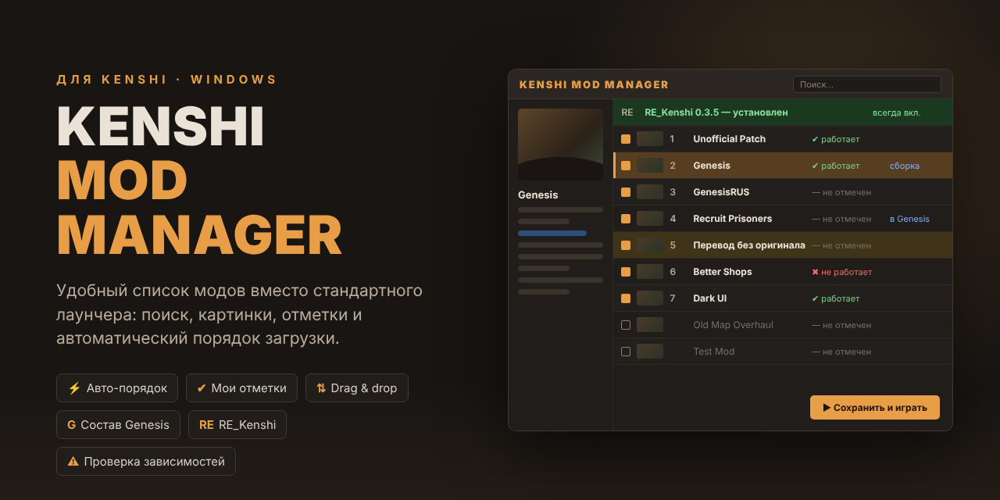

# Kenshi Mod Manager

Удобный менеджер модов для **Kenshi** вместо стандартного лаунчера. Когда модов сотни, в лаунчере невозможно что-то найти и выстроить порядок. Здесь есть поиск, картинки модов, свои отметки «работает / не работает», проверка зависимостей и автоматический порядок загрузки.

Это один скрипт PowerShell: ничего доустанавливать не нужно, работает на любой Windows 10/11.

**[⬇ Скачать последнюю версию](https://github.com/TechnoW1zard/kenshi-mod-manager/releases/latest/download/KenshiModManager.zip)**

---

## Установка (1 минута)

1. **Скачайте** архив [KenshiModManager.zip](https://github.com/TechnoW1zard/kenshi-mod-manager/releases/latest/download/KenshiModManager.zip).
2. **Распакуйте** его в любое место (правый клик → «Извлечь всё»).
3. Запустите **`Установить.bat`**.
   Установщик сам найдёт Kenshi в Steam (в том числе на других дисках), скопирует туда менеджер и создаст ярлык **Kenshi Mod Manager** на рабочем столе.
4. Готово. Дальше запускайте игру через этот ярлык: выставили моды → **«▶ Сохранить и играть»**.

> **Если Windows ругается.** На `.bat`, скачанный из интернета, Windows может показать синее окно «Система Windows защитила ваш компьютер». Нажмите **«Подробнее» → «Выполнить в любом случае»**. Это обычное предупреждение для любого скачанного скрипта.
>
> **Если установщик не нашёл игру,** он попросит указать папку. Это та папка, где лежит `kenshi_x64.exe`.

<b>Установка вручную (без установщика)</b>

1. В Steam: правый клик по **Kenshi** → **Управление** → **Просмотреть локальные файлы**. Откроется папка игры.
2. Скопируйте туда два файла из архива: `KenshiModManager.ps1` и `Kenshi Mod Manager.bat`.
3. Запускайте `Kenshi Mod Manager.bat`. Ярлык на рабочий стол: правый клик по нему → **Отправить** → **Рабочий стол (создать ярлык)**.

### Удаление

Удалите из папки игры `KenshiModManager.ps1`, `Kenshi Mod Manager.bat`, `KenshiModManager.status.json`, `KenshiModManager.rules.txt` и папку `_kmm_cache`, а также ярлык с рабочего стола. Ваш список модов (`data\mods.cfg`) останется таким, каким вы его последний раз сохранили.

---

## Что умеет

- **Поиск** по названию, имени файла, ID в Workshop и автору (Ctrl+F). Фильтры: включённые / выключенные / с проблемами / входящие в Genesis.
- **Картинки и описания.** Слева карточка выбранного мода: превью, автор, даты, зависимости и описание из Workshop.
- **Свои отметки** «✔ работает / ✖ не работает» (Ctrl+1 / Ctrl+2 / Ctrl+0) с фильтром по ним. Удобно, когда проверяете большую сборку.
- **Дата скачивания** каждого мода. По колонке «Скачан» сортировка от новых к старым, так сразу видно, что вы добавили последним.
- **Порядок загрузки:**
  - перетаскивание мышью, кнопки и Alt+↑ / Alt+↓, «На позицию…»;
  - **⚡ Авто-порядок** сам ставит мастер-файлы выше модов, которые от них зависят, а переводы — ниже оригиналов. Перед применением показывает, что и почему сдвинется;
  - свои правила в файле `KenshiModManager.rules.txt` (кнопка «Правила авто-порядка»), например `GenesisRUS.mod > Genesis.mod`.
- **Проверка проблем:** не найден файл мода, дубликаты, не включён нужный мастер, мастер стоит ниже зависящего от него мода. Ошибки подсвечиваются красным, предупреждения жёлтым.
- **Genesis:** менеджер разбирает состав сборки Genesis и показывает, какие ваши моды в ней уже есть, чтобы не держать дубли.
- **RE_Kenshi:** если он установлен, первой строкой показывается его версия и подключён ли он. Включить или выключить его отсюда нельзя: это отдельный загрузчик, а не мод.
- **Безопасность:** перед каждым сохранением делается бэкап `mods.cfg` (хранятся 15 последних, лежат рядом с `data\mods.cfg`). Менеджер предупредит, если сохраняете при запущенной игре или с ошибками в списке.

## Горячие клавиши

| Клавиши | Действие |
|---|---|
| Ctrl+F | Поиск |
| Ctrl+S | Сохранить |
| Alt+↑ / Alt+↓ | Сдвинуть мод выше / ниже |
| Ctrl+1 / Ctrl+2 / Ctrl+0 | Отметка «работает» / «не работает» / сбросить |
| Двойной щелчок | Открыть страницу мода в Steam |
| Правый щелчок | Меню отметок, Steam, папка мода |

## Как это работает

Менеджер читает и пишет тот же файл `data\mods.cfg`, что и стандартный лаунчер Kenshi. Ниже в списке — значит позже загружается и «побеждает» при конфликте. Моды ищутся в `Kenshi\mods` и в папке Steam Workshop (`steamapps\workshop\content\233860`). Названия, картинки и даты берутся из файлов `.info` / `.img` модов, всё работает без интернета.

Свои данные менеджер хранит рядом с игрой:

| Файл | Что в нём |
|---|---|
| `KenshiModManager.status.json` | ваши отметки «работает / не работает» |
| `KenshiModManager.rules.txt` | правила авто-порядка |
| `_kmm_cache\` | миниатюры и разобранный состав Genesis |

## Требования

- Windows 10 или 11 (PowerShell 5.1 уже встроен).
- Kenshi из Steam. Версия из GOG тоже подойдёт при ручной установке: положите файлы рядом с `kenshi_x64.exe`.

## Лицензия

[MIT](LICENSE). Пользуйтесь, меняйте, делитесь.
